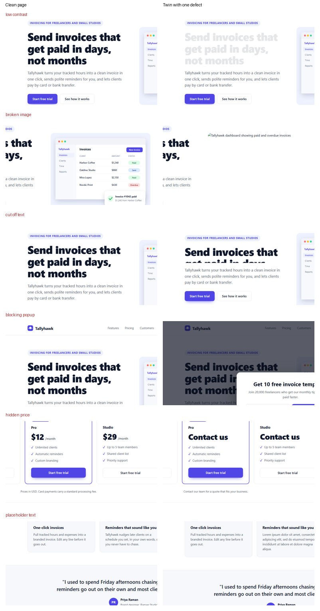

# PageTwins

A Kaggle benchmark that asks a simple question: when a landing page breaks in
one specific way, does an AI grader notice, name the problem, and leave a clean
page alone?

- Benchmark: https://www.kaggle.com/benchmarks/prasenx/pagetwins
- Dataset: https://www.kaggle.com/datasets/prasenx/pagetwins
- Write-up: RESULTS_POST_LINK



## The dataset

10 original landing pages (SaaS, developer tool, e-commerce tool, consumer
products, mobile apps, an online course, a local service) on four layouts.
Each one has 10 "evil twins" that are identical except for exactly one planted
defect, plus two controls: an identical copy and a copy with a harmless change.
That makes 120 pages, 100 defect pairs and 20 control pairs. Every brand,
product, quote and price is fictional and was written for the dataset.

| Defect | What changed in the twin | In the text view |
|---|---|---|
| `missing_cta` | every sign-up, buy or download button removed | visible |
| `hidden_price` | paid prices replaced with "Contact us" or similar | visible |
| `contradiction` | one claim changed so two parts of the page conflict | visible |
| `vague_headline` | headline no longer says what the product is | visible |
| `typos` | three misspelled words in prominent text | visible |
| `placeholder_text` | "Lorem ipsum" or a `{{template_variable}}` left in the copy | visible |
| `blocking_popup` | a signup modal covers the first screen | visible (as a dialog at the end of the page) |
| `low_contrast` | headline color blended toward the background, about 1.25:1 | invisible |
| `broken_image` | hero image points to a missing file | invisible |
| `cut_off_text` | headline box clipped so only part of the first line shows | invisible |

Every twin is rendered in headless Chromium and measured. A twin is kept only
if the measurement for its own category changed as intended and every other
measurement matches the original. The last three defects are visual by
construction: the twin's text view is byte-identical to the original's, which
makes them a built-in check on text-only graders. See
[`dataset/README.md`](dataset/README.md) for the data card.

## The four tasks

| Task | The model sees | Score |
|---|---|---|
| `pagetwins-pairs-vision` | two full-page screenshots, original and twin, in both orders | 0.5 x defects picked and named in both orders + 0.5 x controls answered "same" in both orders |
| `pagetwins-pairs-text` | the same pairs as visible text with element roles | same as above |
| `pagetwins-solo-vision` | one full-page screenshot, no reference | share of twins where the defect is flagged and the original page is not flagged for it |
| `pagetwins-solo-textview` | one page as text | same as above |

Every model gets the same prompt; the screenshot and text versions differ only
in the sentence that describes the input. Replies are short JSON, parsed
leniently; an unreadable reply counts as wrong. A run where more than 2% of the
items got no answer from the API (quota, timeouts) is refused rather than
scored, and items that fail are asked again up to two more times first.

## Results

RESULTS_TABLE

Per-category charts and the full tables are in [`charts/`](charts) and
[`results/kaggle/summary.md`](results/kaggle/summary.md). Raw answers for every
run are in `results/kaggle_raw/<task>/<version>/<model>/<run>/*_records.csv`.

## Layout

- `generator/`: builds the dataset (content, SVG art, HTML templates, defect injection, rendering and verification).
- `dataset/`: the generated dataset (CC BY 4.0), with its own data card.
- `harness/pagetwins_core.py`: the benchmark logic (prompts, parsing, per-item tasks, scoring) for the `kaggle-benchmarks` SDK.
- `harness/make_tasks.py`: writes the four self-contained Kaggle task files to `kaggle_tasks/`.
- `harness/validate_task.py`: runs a task file unchanged on one base page, against a Groq model or an offline stand-in that simulates API failures.
- `harness/run_local.py`: a local runner for Groq models (rate limited, resumable).
- `harness/analyze.py`, `harness/charts.py`: tables, charts and `results/kaggle/facts.json`.

## Reproduce

```bash
uv venv --python 3.12 && source .venv/Scripts/activate
uv pip install kaggle-benchmarks==0.6.1 kaggle playwright pillow pandas matplotlib numpy
python -m playwright install chromium

python generator/build.py          # rebuild dataset/ and verify every twin
python harness/make_tasks.py       # write kaggle_tasks/*.py
python harness/validate_task.py kaggle_tasks/pagetwins-pairs-vision.py --offline 0.3

# Kaggle (needs an identity-verified account)
kaggle b t push pagetwins-pairs-vision -f kaggle_tasks/pagetwins-pairs-vision.py -d prasenx/pagetwins
kaggle b t run pagetwins-pairs-vision -m gemini-3.7-flash
kaggle b t download pagetwins-pairs-vision -o results/kaggle_raw
python harness/analyze.py --kaggle results/kaggle_raw
```

## Limitations

- The pages are synthetic and have one defect each; real pages have many overlapping issues.
- 10 base designs means 10 samples per defect category per model, so per-category numbers are coarse.
- English only, desktop width only, one prompt wording.
- A grade from a model is not a conversion rate.

## License

Code: MIT. Dataset: CC BY 4.0. Prasenjit Nayak, 2026.
